  

**Olá, eu sou a Juliana Saunders!** ⋆.˚ ☾⭒.˚

Sou estudante de Análise e Desenvolvimento de Sistemas, gosto da área de Design e Organização de Projetos.

<b>Tecnologias e Ferramentas</b> 🐈‍⬛

<b>Front-end</b>

<b>Back-end / Runtime</b>

<b>Linguagens</b>

<b>Sistemas e Infraestrutura</b>

<b>Automação</b>

